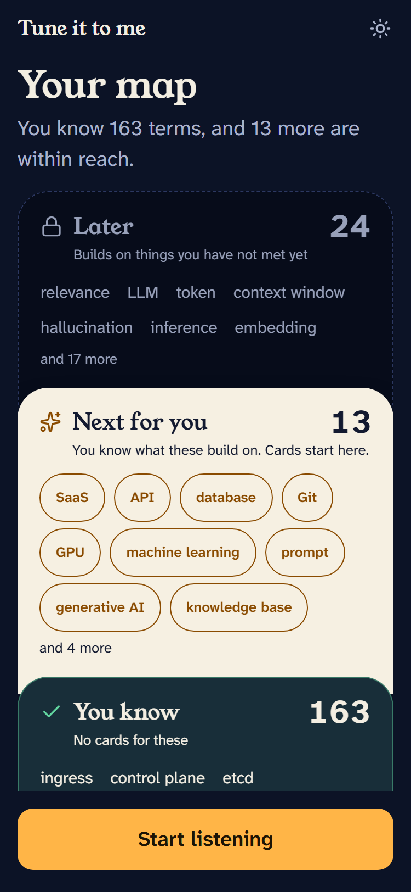
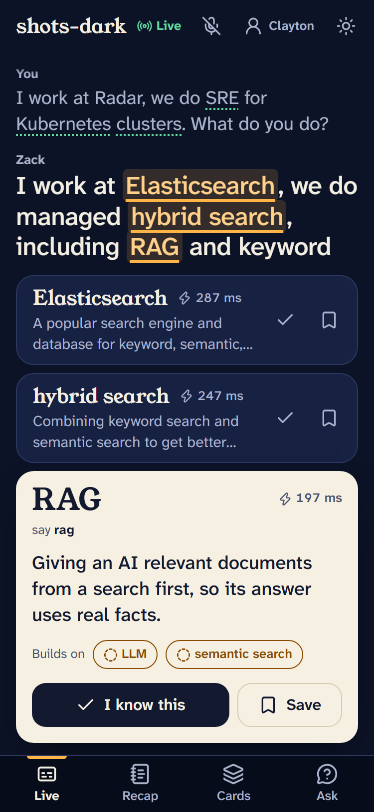
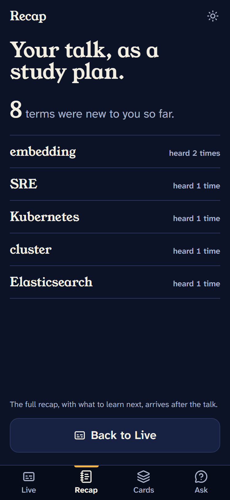
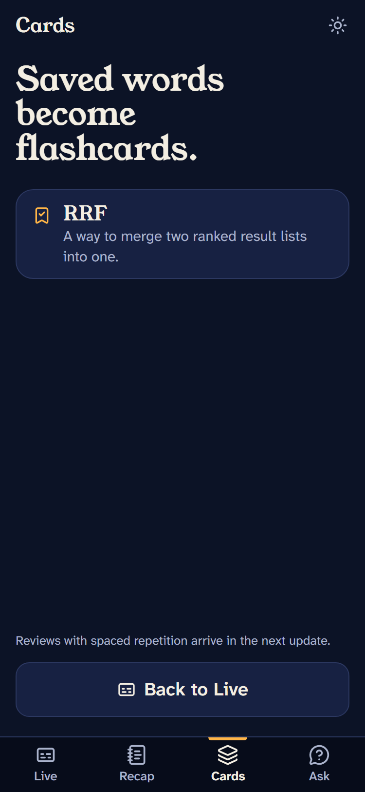
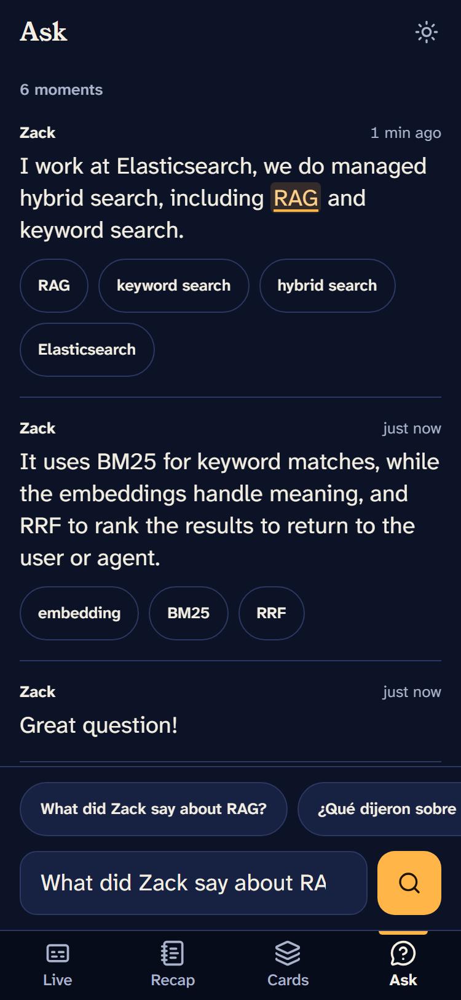
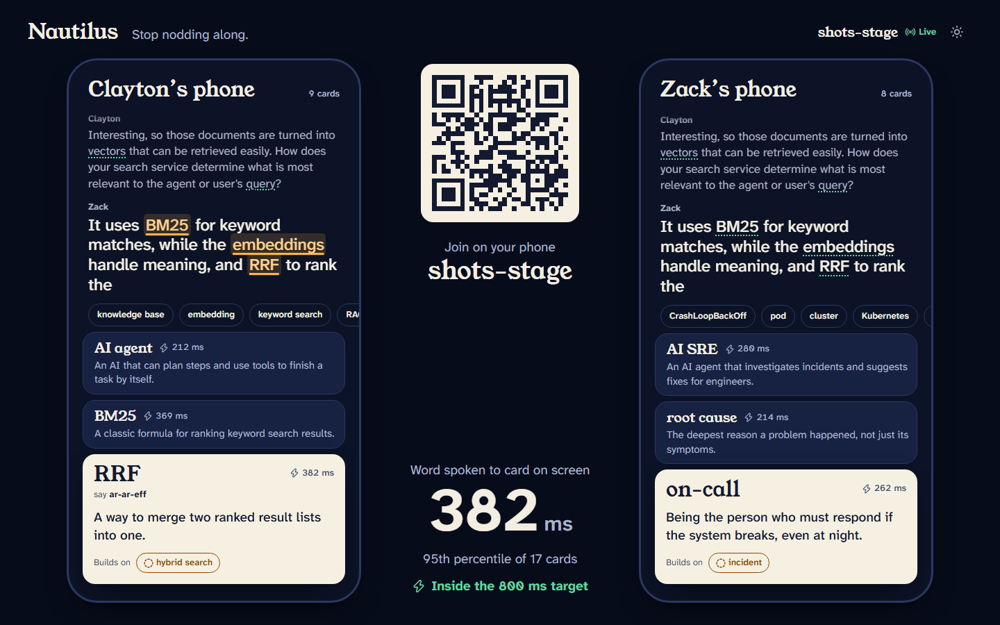

# Nautilus

**Stop nodding along.** Nautilus is a phone app for conference attendees. It shows live
captions of the conversation around you and pops a card only for the jargon *you personally*
don't know, the moment it is said. A one-minute probe maps what you already know, so a
Kubernetes veteran and a first-timer sitting side by side see different cards. Afterwards,
the terms you heard become your recap and flashcards, and you can ask your conference a
question in your own language. Live captions also serve deaf and hard-of-hearing attendees.

Built at the Cloud Native Hackathon (WeMakeDevs, Salt Lake City, Nov 9 2026).
Live: <https://d1e92cjyapmt2m.cloudfront.net> (open it on a phone; `/stage` is the projector view).
The repo, packages, Kubernetes names and metric names keep the working name `confpilot`.
The original build, demo and pitch plan is [docs/CONFPILOT_PLAN.md](docs/CONFPILOT_PLAN.md).

## What was built when

The hackathon rules say main coding must begin after kickoff (11:00 AM MT).

- **`reference/`** holds a scaffold committed between 9:09 and 9:35 AM, before kickoff, for an
  earlier idea (talk search and matchmaking). It is kept for transparency only. Nothing in it
  is built, imported, deployed or submitted, and CI fails if code outside `reference/` uses it.
- **Everything outside `reference/`** was written after 11:00 AM and landed through
  Gitar-reviewed pull requests. The commit history shows this.

## How it works

```
  Phone (PWA, web/)                    16 kHz PCM audio
 +----------------------------------+ -----------------> +-------------------+
 | live captions                    |                    | Deepgram (nova-3) |
 | Tier 1: on-device matcher over   | <----------------- | streaming STT     |
 |   the preloaded 200-term glossary|       words        +-------------------+
 | cards + word-to-card badge       |
 | Recap, Flashcards (SM-2), Ask    |
 +--------+-------------------^-----+
          | HTTPS /api         | WebSocket /ws/rooms/{room}
          | short-lived token, | transcripts, room state,
          | glossary, search   | Tier 2 cards
          v                    |
   CloudFront --> load balancer --> EKS (us-east-1), namespace confpilot
          +--------------------------------------------+
          | api/  FastAPI, one replica                 | <-- Radar (namespace radar)
          |  POST /api/token: mint a Deepgram token    |
          |  room WebSocket hub, probe, recap, search  |
          |  Tier 2: percolate final transcripts and   |
          |    send cards for terms the phone missed   |
          +------+-------------------------------+-----+
                 | es/ (confpilot_es)            | OTLP/HTTP
                 v                               v
   Elastic Cloud Serverless               Dash0: traces, metrics, logs,
   confpilot-terms, -term-queries,        browser RUM, dashboard and SLO
   -utterances, -user-knowledge,
   -sessions
```

- Audio goes from the phone straight to Deepgram. The API only mints the short-lived token
  ([api/confpilot/routes/token.py](api/confpilot/routes/token.py)), so no key reaches the browser.
- Tier 1 cards come from the phone's own matcher ([web/src/lib/match](web/src/lib/match)), which
  follows the same rules as the server ([contracts/README.md](contracts/README.md)).
- Tier 2 is the Elasticsearch percolator: each final transcript is run against one stored query
  per term, and cards go out for terms the phone missed.
- Elasticsearch is the only data store. An LLM is optional and never in the live card path.

## Screens

| Onboarding probe | Live | Recap | Flashcards | Ask your conference |
| --- | --- | --- | --- | --- |
|  |  |  |  |  |

1. **Onboarding probe**: talk for a moment and check a few terms; Nautilus builds your
   knowledge map and only shows cards for terms on it you don't know.
2. **Live**: captions plus cards, each with a latency badge (word spoken to card on screen).
3. **Recap and Flashcards**: what you heard, ranked by what to learn next, reviewed with SM-2.
4. **Ask your conference**: hybrid search over what was said. A Spanish question finds the
   English moment.

`/stage` shows two phones side by side for the projector:



All screenshots are in [web/docs/screens/](web/docs/screens/).

## Layout

| Path | What | Owner |
| --- | --- | --- |
| `contracts/` | API and event shapes every part agrees on, plus shared matcher fixtures | all (change by PR) |
| `api/`, `es/` | FastAPI service (token, session, probe, room WebSocket hub, knowledge, recap, search) and the Elasticsearch layer `confpilot_es` (mappings, bootstrap, percolator, hybrid search, recap) | Zack |
| `web/` | Phone app (PWA), stage view, mock server, screenshots | Tanner |
| `observability/` | Dash0 dashboard and SLO as code, with the commands that apply them | Tanner |
| `deploy/` | Dockerfile, EKS config, Kustomize manifests, rollout scripts, deploy runbook | Clayton |
| `content/`, `.gitar/`, `docs/` | The 200-term glossary and its validator, Gitar rules, plan and setup guides | Skyler |
| `.github/workflows/` | CI for each part, deploy on merge, Gitar labelling | shared |
| `bin/` | Helper scripts for delegating tasks to coding subagents | shared |
| `recordings/` | A short clip of our own rehearsal | shared |
| `reference/` | Pre-kickoff scaffold, not part of the submission | nobody |

## Run it locally

Needs Python 3.12 with [uv](https://docs.astral.sh/uv/), Node 22.18+ and pnpm.
Copy `.env.example` to `.env` and fill in what you have; every setting is optional for a first run.

```powershell
# API on :8000 (in-memory store unless ES_URL is set)
cd api
uv sync
uv run uvicorn confpilot.main:app --host 0.0.0.0 --port 8000 --ws-ping-interval 20 --ws-ping-timeout 20

# Phone app on Vite's dev server; proxies /api and /ws to :8000 (override with CONFPILOT_API)
cd web
pnpm install
pnpm dev
pnpm mock        # instead of the API: a scripted room with no backend and no microphone

# Elasticsearch indices and glossary (idempotent)
cd es
uv sync
uv run python -m confpilot_es.bootstrap --glossary ..\content\glossary.json
```

Tests: `uv run pytest` in `api/` and `es/` (live ES tests skip without credentials), and
`pnpm lint`, `pnpm typecheck`, `pnpm test` in `web/`.

Environment variable names (values never go in the repo):

- API: `DEEPGRAM_API_KEY`, `DEEPGRAM_TOKEN_TTL_S`, `ES_URL`, `ES_API_KEY`, `ES_INDEX_PREFIX`,
  `LLM_BASE_URL`, `LLM_API_KEY`, `LLM_MODEL`, `SESSION_SECRET`, `ALLOWED_ORIGINS`,
  `STATIC_DIR`, `GLOSSARY_PATH`
- Telemetry: `OTEL_EXPORTER_OTLP_ENDPOINT`, `OTEL_EXPORTER_OTLP_HEADERS`, `OTEL_SERVICE_NAME`
- Web build: `VITE_DASH0_RUM_TOKEN`, `VITE_DASH0_RUM_ENDPOINT`

Details: [api/README.md](api/README.md), [es/README.md](es/README.md),
[content/README.md](content/README.md), [contracts/README.md](contracts/README.md).

## Deploy

One image (FastAPI plus the built phone app) runs on EKS in `us-east-1` behind CloudFront.
Every merge to `main` builds the image and rolls it out. The runbook, from an empty cluster to
the public URL, is [deploy/README.md](deploy/README.md).

## Sponsor tracks

### Gitar: every change reviewed

Every change after kickoff landed as a pull request reviewed by Gitar, with auto-apply on.

- Custom rule: [.gitar/rules/confpilot-guardrails.md](.gitar/rules/confpilot-guardrails.md)
  (spans on routes, no LLM in the live path, accessibility, Kubernetes probes and limits, glossary quality)
- Review instructions: [.gitar/review/confpilot.md](.gitar/review/confpilot.md)
- Auto-apply policy: [.gitar/config/apply.md](.gitar/config/apply.md), turned on for every PR by
  [.github/workflows/gitar-auto-apply.yml](.github/workflows/gitar-auto-apply.yml)

### Dash0: latency is the product

The promise is that 95% of cards appear within 800 ms of the word being spoken, and Dash0 measures it.

- API traces, metrics and logs over OTLP: [api/confpilot/telemetry.py](api/confpilot/telemetry.py)
- The `card.push` span and the `confpilot.card.word_to_card_ms` histogram (by tier):
  [api/confpilot/routes/ws.py](api/confpilot/routes/ws.py)
- Elasticsearch spans (`es.percolate`, `es.search`, ...): [es/confpilot_es/telemetry.py](es/confpilot_es/telemetry.py)
- Browser RUM: [web/src/telemetry/dash0.ts](web/src/telemetry/dash0.ts)
- Dashboard "confpilot-word-to-card" and the SLO "Cards on screen within 800 ms" (95% target),
  kept as code in [observability/dash0/](observability/dash0/) and applied with the Dash0 API
  ([observability/README.md](observability/README.md)); latency measurements in [docs/PERF.md](docs/PERF.md)
- Tier 2: every final is percolated in Elasticsearch (`utterance.percolate`, `es.percolate` spans),
  and terms the phone missed go out as `card.server` cards: [api/confpilot/utterances.py](api/confpilot/utterances.py)
- Setup: [docs/setup/DASH0.md](docs/setup/DASH0.md)

### Radar: operating the cluster

Radar runs inside the EKS cluster in the `radar` namespace. We reach its UI and read-only MCP
through a local port-forward, so it is never public. Every workload carries
`app.kubernetes.io/*` labels so Radar groups it under `confpilot`.

- How to connect: [docs/setup/RADAR.md](docs/setup/RADAR.md)
- Manifests and runbook: [deploy/k8s/](deploy/k8s/), [deploy/README.md](deploy/README.md)

### Elasticsearch: the only database

- Mappings for the five `confpilot-*` indices: [es/mappings/](es/mappings/)
- Percolator jargon detection: [es/confpilot_es/percolate.py](es/confpilot_es/percolate.py),
  [es/confpilot_es/queries.py](es/confpilot_es/queries.py)
- Hybrid BM25 + `semantic_text` search fused with RRF, multilingual:
  [es/confpilot_es/search.py](es/confpilot_es/search.py)
- Recap by aggregation and the "learn next" ranking: [es/confpilot_es/knowledge.py](es/confpilot_es/knowledge.py)
- How the API uses it: [api/confpilot/store_es.py](api/confpilot/store_es.py)
- Queries to paste into Kibana: [es/README.md](es/README.md)

### Merge Forward: accessibility and inclusion

- Live captions for deaf and hard-of-hearing attendees: [web/src/live/Captions.tsx](web/src/live/Captions.tsx)
- Screen-reader announcements of finished sentences and new cards: [web/src/live/Announcer.tsx](web/src/live/Announcer.tsx)
- Large, readable type that follows the system text size, dark and light themes, and
  `prefers-reduced-motion`: [web/src/index.css](web/src/index.css)
- Accessible names on every control and 44 px tap targets are review rules; CI lints the app
  with the jsx-a11y rules ([.github/workflows/web.yml](.github/workflows/web.yml))
- Plain-English definitions of 20 words or fewer: [content/README.md](content/README.md)

## Privacy

Audio is never stored. It streams from the phone to Deepgram for transcription and never
reaches our API. Final transcripts are stored in Elasticsearch (`confpilot-utterances`: the
text, the speaker's display name, the room, the time and the matched terms) to power search
and the recap, along with each user's known terms and review schedule. Everyone in the demo
conversation consented to being recorded and transcribed.

## Credits

- LearnHarness (AGPL-3.0) inspired some ideas. No code was copied from it.
- Team: Zack, Clayton, Tanner and Skyler.

## AI disclosure

We used AI coding assistants throughout, as the rules allow: Claude Code, OpenAI Codex and
DeepSeek subagents. Humans set the plan, reviewed every pull request alongside Gitar, and can
explain the architecture.
